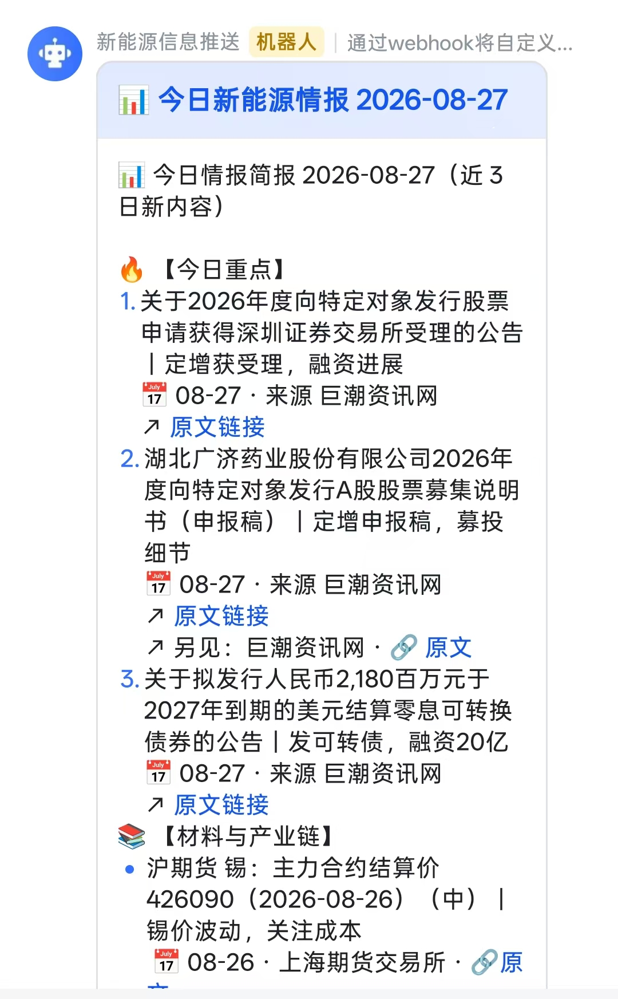
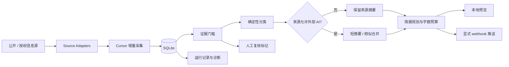

<div align="center">

# intel-daily

### AI 辅助的每日行业与投资信息管线

把分散的信息源整理成可追溯、可复核、可控制的每日情报简报

<p>
  
  
  
  
</p>

<p><i>少一点重复搬运，多一点可回溯的研究时间。</i></p>

</div>

> GitHub 公开仓库名：`intel-daily-public`；代码项目名和本地包名保留为 `intel-daily`。

> 这是信息收集与研究辅助工具，不是实时行情终端、自动投资 Agent 或投资建议系统。

## 项目简介

研究工作中经常需要同时关注政策、能源、产业链、公司公告和国际数据。真正消耗时间的，往往是重复打开网页、判断哪些内容是新的、去掉同一事件的重复报道，再把重点整理成一条可以发给团队的简报。

`intel-daily` 把这条流程做成一个本地优先的管线：

```text
信息源
    → 增量采集
    → SQLite 归一化与幂等去重
    → 证据门槛
    → 确定性分类
    → 可选 LLM 短摘要 / 相似合并
    → 字数受控的每日简报
    → 本地预览或显式推送
```

系统始终保留原始链接、来源和发布时间，AI 只负责有限的整理工作，不把生成文本当成事实证明。

## Demo

### 每日新能源情报推送

<p align="center">
  
</p>

截图展示了现有推送 Demo 的信息结构：每日标题、重点事项、行业与材料信息、来源、日期和原文链接。推送通过 webhook 发送到团队协作工具；真实部署时不会把 webhook 写入仓库。

### 本地合成示例

仓库提供一份不含真实公司、价格和内部报告的合成简报：

👉 [查看合成简报](examples/sample-brief.md)

## 核心能力

| 能力 | 解决的问题 | 当前实现 |
| --- | --- | --- |
| 增量采集 | 每天只处理新的信息 | 按来源维护 cursor，支持重复运行 |
| 统一存储 | 不同来源字段不一致 | SQLite 归一化、外部 ID 与幂等 upsert |
| 证据控制 | 避免没有出处的内容进入简报 | 标题、发布者、时间、HTTP 原文链接检查 |
| 内容整理 | 降低人工筛选与重复阅读 | 确定性分类、重要性分级、相似内容合并 |
| AI 增强 | 对重点内容做短摘要 | 外部模型按来源逐项 opt-in，可关闭 |
| 稳定交付 | 单一来源失败不拖垮全流程 | 来源级隔离、运行记录、重试和每日锁 |
| 输出控制 | 简报不能无限变长 | 字数预算、低优先级裁剪、关联链接保留 |

## 系统结构



## AI 的位置与边界

AI 是可选增强层，不是系统唯一依赖：

- 采集、cursor、外部 ID、幂等写入和证据检查是确定性的。
- 没有 AI key 时，项目仍可运行本地 stub 和非 AI 流程。
- 外部模型只接收受限的标题/摘要内容，用于短摘要或相似内容分组。
- 每个来源有 `allow_external_ai` 开关，敏感来源可以始终留在本地。
- 模型失败时记录降级状态，不把模型输出当作交叉事实核验。

当前明确不包含：实时突发新闻、长篇报告、自动投资建议、跨来源事实核查、多 Agent 编排和公共 SaaS 控制台。

## 快速运行

```bash
# 安装依赖
uv sync

# 创建本地环境配置
cp .env.example .env
# 编辑 .env，至少设置 INTEL_ADMIN_PASSWORD

# 启动本地控制台
uv run python -m intel_daily.web
```

打开 <http://127.0.0.1:8000>。

只想运行一次并预览简报、不发送真实消息：

```bash
uv run python -m intel_daily.worker --once --preview
```

需要使用外部模型时，再配置 `INTEL_AI_API_KEY`，并逐一确认来源的外部 AI 开关。需要推送时，配置 `INTEL_FEISHU_WEBHOOK` 并使用显式 send 模式；不要把密钥或 webhook 写入代码、截图或日志。

## 工程验证

- Python：`266 passed`
- 覆盖适配器、分类、证据门槛、去重、摘要、简报、通知、worker 和 Web 契约
- 支持 Docker Compose 的单机部署路径
- 预览和 dry-run 不会向真实 webhook 发送消息

## 目录结构

```text
src/intel_daily/
  adapters/       来源采集与解析
  classify.py     确定性分类与重要性规则
  items.py        SQLite 数据与幂等写入
  similarity.py   可选相似内容合并
  summarizers.py  本地 stub 与兼容 OpenAI API 的摘要器
  digest.py       简报规划与字数控制
  notifier.py     预览与 webhook 推送
  worker.py       每日编排与命令行入口
  web.py          本地控制台
tests/            离线行为和契约测试
examples/         合成、隐私安全的输出示例
docs/assets/      Demo 截图素材
```

## 数据源与安全边界

- 当前包含 7 个 worker 注册的数据源适配器：能源、公告、期货、汽车、乘用车、贸易等公开或授权信息路径。
- 上游网页、接口、数据内容和商标不因本仓库使用 MIT 而获得再分发授权。
- API key、管理员密码、webhook、Cookie 和部署配置必须通过环境变量或部署平台注入。
- 使用者需要自行确认每个数据源的访问权限、频率限制、商业许可和使用条款。
- 本仓库不包含内部日报、私有部署文档、真实团队消息或生产凭证。

## 为什么值得展示

这个项目体现的不是“调用一个模型生成摘要”，而是一条完整的研究信息工作流：

1. 发现信息源并维护增量状态。
2. 保存出处与证据，避免内容脱离原文。
3. 用确定性规则保证 AI 不可用时系统仍可运行。
4. 把 AI 限制在短摘要和相似归并等低风险环节。
5. 在发送前保留预览、dry-run 和人工控制。

## 路线图

- 增加经过条款审查、带离线契约测试的新来源。
- 改进来源差异和人工复核界面。
- 为未来的授权数据源提供清晰的 provider interface。
- 保持实时告警、长报告和自主决策能力与核心管线解耦。

## 免责声明

本项目用于教育和研究工作流，不构成投资建议，不保证信息完整性、及时性或准确性。使用者应独立打开原文核验，并遵守适用法律、数据许可和上游服务条款。

## License

原始代码采用 [MIT License](LICENSE)。上游数据、网站、商标、接口和第三方服务仍受其各自权利人约束。
